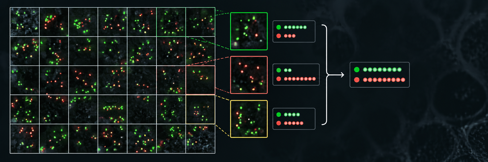

<p align="center">
  
</p>

# TileCount Vision

**Turn difficult image counts into small, auditable decisions.**

TileCount Vision is a Codex skill for counting spots, cells, puncta, and other compact objects inside a selected image region. It divides the region into non-overlapping tiles no larger than 100x100 pixels, inspects every tile, assigns boundary objects by center, and exports both per-tile evidence and a deduplicated total.

It is especially useful when a full microscopy image contains dense texture, fibers, mesh-like structures, uneven brightness, or dim candidates that make one-pass counting unreliable.

## Why it exists

Large images encourage missed objects, false positives, and accidental double counting. TileCount Vision makes the process inspectable:

- exact region coordinates;
- non-overlapping tiles;
- one recorded result per tile;
- center-based boundary ownership;
- explicit exclusions and ambiguity;
- optional separate totals for clear and dim objects;
- CSV evidence plus a JSON summary.

## Install

Clone this repository into your Codex skills directory:

```bash
git clone https://github.com/YOUR-USERNAME/tilecount-vision.git ~/.codex/skills/tilecount-vision
```

Restart Codex if the skill does not appear immediately.

## Use

Invoke the skill and provide an image plus a pixel region:

```text
Use $tilecount-vision to count green fluorescent spots in x=0, y=674,
width=1024, height=350. Exclude reticular fibers. Report clear and dim
objects separately and save the per-tile CSV.
```

The skill supports any rectangular region. Edge tiles are automatically smaller when the region is not divisible by 100.

## Generate a tile manifest

```bash
python3 scripts/make_tile_manifest.py \
  --x0 0 --y0 674 --width 1024 --height 350 \
  --output tile_manifest.csv
```

This produces 44 non-overlapping tiles: thirty 100x100 tiles, three 24x100 right-edge tiles, ten 100x50 bottom-edge tiles, and one 24x50 corner tile.

## Output

The standard output is:

- a CSV with coordinates, counts, confidence, ambiguous candidates, and exclusions for every tile;
- a JSON summary with the exact region, tile dimensions, total, uncertainty, and evidence path;
- optionally, separate `clear_count`, `dim_additional_count`, and `inclusive_total` values.

## Scope and limitations

This skill structures and audits a counting workflow; it does not turn subjective image interpretation into ground truth. Dim or merged objects should remain marked as uncertain when the available pixels do not support a reliable decision. Scientific conclusions should be validated against appropriate human annotations and experimental controls.

## License

MIT
